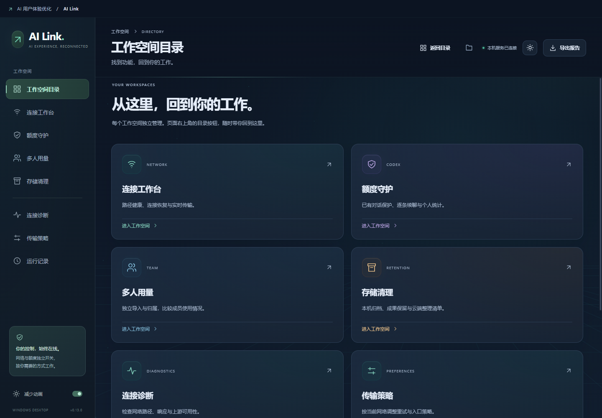

# AI Link Desktop · 0.13.0

Some useful tools help enhance the using experience of Codex.

「AI 用户体验优化」的 Windows 桌面应用。Vue 3、TypeScript、Electron 前端与 Python 本地服务通过受限 IPC 通信，不启动 HTTP 控制网站。



## 工作空间

| 功能 | 内容 |
| --- | --- |
| 连接工作台 | 本地代理主备、自适应选路、错峰竞速、重试、保活与实时流量 |
| 额度守护 | Plus／Pro 独立短期和长期阈值、多对话保护、逐条续聊和个人上限 |
| 多人用量 | 成员归属、JSONL／年／月／日目录导入、去重、20 色环图及导出 |
| 存储清理 | 本机与云端导出分区、时间与工作区筛选、成果保留、备份和恢复 |
| 连接诊断 | 路径、响应、健康、耗时与报告 |
| 传输策略 | 入口、连接超时、重试和策略选择 |
| 运行记录 | 本次连接与守护事件 |

默认进入工作空间目录，每页可返回目录或打开数据文件夹。各功能保留独立颜色；新增有帧率上限的流动网格、信号光线、指针光场和卡片光泽。按钮波纹平滑展开，点击目标稳定。支持深浅色、系统／应用减少动画与窗口缩放；窗口不可见时暂停背景动画。

## 源码运行

已验证 Windows 11 x64、Python 3.13.7、Node 22.20.0。本应用仅支持 Windows。

在根目录打开 PowerShell：

```powershell
python -m venv .venv
.\.venv\Scripts\python.exe -m pip install -r requirements-dev.txt
cd desktop-app
npm ci
npm run build
npm start
```

主进程优先使用项目根目录虚拟环境，也可设置 AI_LINK_DEV_PYTHON。npm start 打开真正的桌面窗口；只有前端构建不会启动后端。全新配置下，代理接管、额度保护和自动续聊默认关闭。个人统计仍按设计每 120 秒读取本机 Codex 日志。

## 构建便携应用

安装依赖后，在根目录执行：

```powershell
.\build-vue-desktop.ps1 -FreshProfile
```

产物是 dist-vue/AI Link/AI Link.exe，请保留同目录所有资源。发行版内置 Electron 与 Python 服务，用户无需另装 Python／Node。

-FreshProfile 使用新的 AI Link 状态与 Electron 配置命名空间，不读取旧版应用的偏好、团队导入或回收区，也不清除旧数据。官方 Codex 账号和 sessions 仍由官方 CLI 管理。文件包不含缓存，运行后会产生新的本地缓存。不带此参数构建时使用默认应用数据目录。当前未代码签名，没有安装器或自动更新。

## 验证与 GitHub

```powershell
.\scripts\verify.ps1
# 有本机 Codex CLI 时执行额外隔离联调：
.\scripts\verify.ps1 -TestCodex
# 构建后检查实际打包服务；没有 Codex 时加 --skip-shared：
.\.venv\Scripts\python.exe tests/smoke_packaged.py
.\.venv\Scripts\python.exe tests/smoke_desktop.py
```

GitHub Actions 配置了 Windows 单元、IPC、界面、构建和打包检查。首次拉取源码需要安装锁定依赖；仓库不含 node_modules、虚拟环境、编译结果、历史版本、日志、登录信息或真实聊天。实际结果见 [测试报告](docs/test-report.md)。源码可直接提交 GitHub，ZIP／EXE 发行产物建议放到 Releases。

桌面启动检查会临时打开实际应用，使用隔离数据与仅本机可访问的调试端口，检查后自动关闭；日常启动不带调试端口。源码打包可运行 `python scripts/package_source.py AI-Link-GitHub.zip`，脚本仅包含允许的源文件并生成 SHA-256 校验信息。

## 能力边界

- 本地优化无法消除 VPN 整体断线、服务端故障或物理带宽限制，不解密 TLS，不重放已提交请求。
- Codex 原生独立进程未开放共享接口时，不能直接控制其中活动对话。同服务跨客户端控制已验证，已释放的本地历史可接入。
- 自动续聊只处理可确认的未完成目标；已完成回合跳过，结果未知不盲目重放。真实 Pro 与自然整周期满额未验收。
- 云端分区支持官方导出的本地整理、成果保留和官方页面交接；未接入云端聊天／记忆删除，附件只索引、不下载。
- 本机清理先预览、备份和校验，运行、近期、固定、守护和派生目标受保护。归档暂不释放空间；永久清除前检查成果。缓存按钮仅清理 AI Link 自身 HTTP 资源缓存，不清空 Codex 原生缓存、模型上下文或进程 RAM。
- 多人共享日志目录不能自动识别作者；个人 tokens 观察值不能换算为套餐百分比。

详见 [架构](docs/architecture.md)、[操作说明](docs/features.md)、[额度控制](docs/quota-guard.md)、[清理说明](docs/storage-cleanup.md)、[数据安全](SECURITY.md)。
