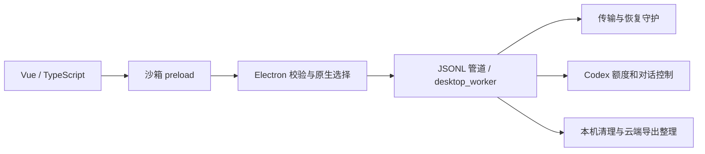

# 桌面架构

desktop-app/src 保存界面、主题与有界 Canvas 背景。动画按可见性及用户偏好暂停，不移动按钮；工作空间配色独立。

desktop-app/electron 保存主进程、安全 preload、允许列表、原生导入及永久清理确认。只加载打包资源，官方链接限制来源和路径后交给默认浏览器。

desktop_worker.py 是桌面后端入口；ailink/instance.py 按状态目录隔离单实例锁，测试及全新配置不唤起旧窗口。独立守护在异常退出后比较归属并恢复代理。

ailink 包含传输、诊断、配额、统计和清理状态机。动作意图先持久化，未知发送／删除结果不自动重放。用户正文与恢复数据不进入源码或诊断报告。

tests 使用合成记录与本机服务。部分旧 Python 布局和 HTTP 边界代码仅用于兼容回归，不参与 Electron 产品启动或打包；HTTP 检查只使用 tests/fixtures。

PyInstaller 构建服务，Vite 资源与 Electron 组成便携目录。源码导出使用文件允许列表，缓存、运行数据和历史构建不能进入 GitHub ZIP。
